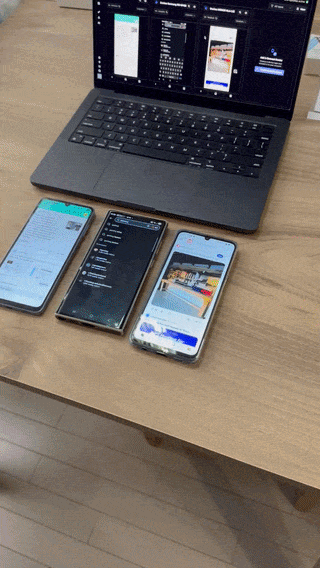
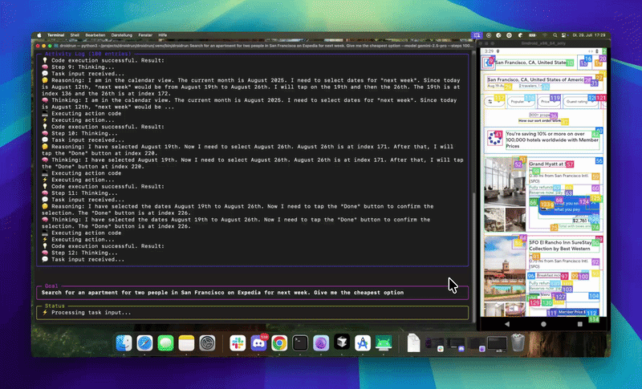
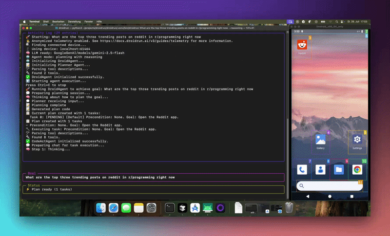

<picture align="center">
  <source media="(prefers-color-scheme: dark)" srcset="./assets/static-images/mobilerun-dark.png">
  <source media="(prefers-color-scheme: light)" srcset="./assets/static-images/mobilerun.png">
  
</picture>

<p align="center">
  <strong>Mobilerun is an open-source framework for mobile app testing, QA, and running AI agents on real Android and iOS devices.</strong><br>
  It gives agents mobile-native tools to inspect UI state, understand screenshots, tap, swipe, type, plan multi-step workflows, and return results through a CLI or Python API.
</p>

<div align="center">

<a href="https://docs.mobilerun.ai">📕 Documentation</a>
·
<a href="https://cloud.mobilerun.ai">☁️ Mobilerun Cloud</a>
·
<a href="https://github.com/droidrun/mobile-harness">🛡️ Mobile Harness</a>

[](https://github.com/droidrun/mobilerun/stargazers)
[](https://mobilerun.ai)
[](https://x.com/mobilerun_ai)
[](https://discord.gg/ZZbKEZZkwK)
[](https://t.me/+_r43WkbbyiA1OGUy)
[](https://mobilerun.ai/benchmark)


<picture>
  <source media="(prefers-color-scheme: dark)" srcset="https://api.producthunt.com/widgets/embed-image/v1/top-post-badge.svg?post_id=983810&theme=dark&period=daily&t=1753948032207">
  <source media="(prefers-color-scheme: light)" srcset="https://api.producthunt.com/widgets/embed-image/v1/top-post-badge.svg?post_id=983810&theme=neutral&period=daily&t=1753948125523">
  <a href="https://www.producthunt.com/products/droidrun-framework-for-mobile-agent?embed=true&utm_source=badge-top-post-badge&utm_medium=badge&utm_source=badge-droidrun" target="_blank"></a>
</picture>


[Deutsch](https://zdoc.app/de/droidrun/mobilerun) | 
[Español](https://zdoc.app/es/droidrun/mobilerun) | 
[français](https://zdoc.app/fr/droidrun/mobilerun) | 
[日本語](https://zdoc.app/ja/droidrun/mobilerun) | 
[한국어](https://zdoc.app/ko/droidrun/mobilerun) | 
[Português](https://zdoc.app/pt/droidrun/mobilerun) | 
[Русский](https://zdoc.app/ru/droidrun/mobilerun) | 
[中文](https://zdoc.app/zh/droidrun/mobilerun)

</div>


<p align="center">
  
</p>

## What is Mobilerun?

Mobilerun controls Android and iOS devices from Python or a CLI. Use direct device actions, record and replay macros, or delegate a task to an AI agent. Devices can be local or hosted in [Mobilerun Cloud](https://cloud.mobilerun.ai).

## Install

Requires Python 3.11–3.13.

```bash
pip install mobilerun
# Or, in a uv project:
uv add mobilerun
# Or install the CLI as a tool:
uv tool install mobilerun
```

Sandbox APIs require `pip install 'mobilerun[sandbox]'`.

Local AI agents require `mobilerun-agents`, a separate add-on that is not yet publicly published. There is no public pip or uv install command for the add-on. The base CLI, direct device actions and macros do not require it.

## 60-second quickstart

Connect an Android device or emulator with [ADB](https://developer.android.com/studio/releases/platform-tools) and USB debugging, then set up Portal:

```bash
mobilerun device setup DEVICE
mobilerun device ping DEVICE
```

Or use Python directly (replace the serial):

```python
import asyncio
from mobilerun.core.devices import AndroidDevice

async def main():
    async with AndroidDevice("emulator-5554") as device:
        await device.start_app("com.android.settings")
        await device.press_button("home")

asyncio.run(main())
```

## Features

- **CLI and Python:** Inspect devices, run agent tasks, and build automation workflows.
- **Android and iOS:** Drive Android with Portal, iPhones via mobilerun-ios, and iOS simulators with iOS Portal.
- **Portal control:** Inspect UI trees and screenshots; launch apps, tap, swipe and type.
- **Vision:** Use `--vision` to include screenshots or `--vision-only` for screenshot-only control.
- **Reasoning:** Use `--reasoning` for manager–executor planning.
- **Tracing:** Inspect runs with Arize Phoenix, Langfuse, logs and saved trajectories.
- **Structured output:** Return typed results from tasks.
- **Webhooks:** Send [sandbox function results](mobilerun/sandbox/README.md#send-a-function-result-to-a-webhook) to an HTTPS receiver.
- **Custom tools:** The `mobilerun-agents` add-on supports custom agent actions.
- **Docker:** The repository's [Dockerfile](Dockerfile) builds a container whose entrypoint is the Mobilerun CLI.

### Build the Docker image

Run this from the repository root every time you build the image:

```bash
git submodule update --init && git -C skills ls-files -z > SKILLS-RECORD && docker build -t mobilerun .
```

This refreshes the list of tracked skills before Docker builds the wheel without Git metadata, so submodule updates are reflected in the image.

### LLM providers

The configuration wizard supports OpenAI, Anthropic, Gemini, xAI, Ollama, MiniMax, ZAI and OpenAI-compatible endpoints such as OpenRouter, LM Studio and vLLM. The CLI also lists DeepSeek. Provider credentials and usage charges depend on your selection. Anthropic and DeepSeek support are provided by the required `mobilerun-agents` add-on; no provider extra is needed.

## Easy examples

The Python snippets below use an `async def` function. Run it with `asyncio.run(...)`, as above. Device examples require a configured Portal.

### Local Android and iOS

```python
from mobilerun.core.devices import AndroidDevice, IOSDevice

async def devices():
    async with AndroidDevice("emulator-5554") as android:
        await android.press_button("home")
    async with IOSDevice("http://localhost:8100") as ios:
        await ios.press_button("home")
```

Use the actual iOS Portal or mobilerun-ios URL for your setup. See [device setup](https://docs.mobilerun.ai/framework/guides/device-setup).

### Cloud phone and proxy

**Cost:** creating a cloud phone and using its proxy can incur charges. Authenticate with `mobilerun account login` or `MOBILERUN_API_KEY` first.

```python
from mobilerun.core.devices import CloudDevice
from mobilerun.core.proxy import CloudRotatingProxy

async def cloud_phone():
    async with CloudDevice(name="demo", billing="paid", plan="minute",
                           proxy=CloudRotatingProxy(country="US")) as phone:
        await phone.press_button("home")
```

The context manager releases resources it creates; existing IDs are not automatically released. `keep=True` retains created resources. `MOBILERUN_BILLING` sets the default billing mode (`no_commerce` blocks purchases, `included` uses enforced included quotas); an explicit `billing=` argument overrides it, so the paid examples here still permit charges.

### Run an agent task

**Cost:** local agent tasks can consume LLM tokens; cloud tasks consume credits.

```python
# Requires the unpublished mobilerun-agents add-on.
from mobilerun_agents import AgentOperator
from mobilerun.core.devices import AndroidDevice

async def task():
    async with AndroidDevice("emulator-5554", operator=AgentOperator()) as device:
        print(await device.do("Open Settings"))
```

Configure an LLM first with `mobilerun agent llm configure`. `CloudDevice` uses a cloud task operator by default.

### Record and replay a macro

Record actions on a local emulator, then publish the replayable steps as a versioned macro. These examples use no cloud resources or LLM tokens.

```python
from pathlib import Path
from mobilerun.core.devices import AndroidDevice, RecordingDevice
from mobilerun.macro import build_macro

async def record() -> Path:
    async with RecordingDevice(AndroidDevice("emulator-5554")) as recorded:
        await recorded.press_button("home")
        recorded.finish("succeeded")
        assert recorded.run_dir is not None
        return build_macro(recorded.run_dir / "steps.jsonl", "go-home")
```

Reset the emulator to its initial screen, then replay the path returned by `record()`:

```python
from pathlib import Path
from mobilerun.core.devices import AndroidDevice
from mobilerun.macro import MacroPlayer, load_macro

async def replay(path: Path):
    async with AndroidDevice("emulator-5554") as device:
        await MacroPlayer(device).replay_macro(load_macro(path))
```

### Credentials and vault

Vault access uses your cloud account. Bind a provider to a device rather than putting secrets in a prompt. Cloud tasks require `CloudCredentials`; local credential providers are not sent to cloud tasks.

```python
from mobilerun.core.credentials import CloudCredentials
from mobilerun.core.devices import AndroidDevice

async def credentials():
    async with AndroidDevice("emulator-5554") as device:
        vault = CloudCredentials()
        await vault.bind(device)
        try:
            print(await vault.list("com.example.demo"))
        finally:
            await vault.close()
```

See [vault_demo.py](tests/demos/vault_demo.py) for save, use and cleanup.

For a local agent, use a private YAML or JSON file with `FileCredentials` instead. The file must not be readable by other users (`chmod 600 secrets.yaml`). LLM use can incur provider charges.

```python
# Requires the unpublished mobilerun-agents add-on.
from mobilerun_agents import AgentOperator
from mobilerun.core.credentials import FileCredentials
from mobilerun.core.devices import AndroidDevice

async def local_credentials():
    async with AndroidDevice("emulator-5554", operator=AgentOperator()) as device:
        provider = FileCredentials("secrets.yaml")
        await provider.bind(device)
        try:
            print(await device.do("Open Settings"))
        finally:
            await provider.unbind()
```

See [credentials](mobilerun/core/credentials/README.md) for file format and provider details. Keep secrets out of prompts and version control.

### Phone numbers and mailboxes

**Cost:** renting a number or creating a mailbox can incur charges. These demos ask for confirmation and release new resources unless `--keep` is used.

```bash
python -m tests.demos.phone_demo --country US
python -m tests.demos.mailbox_demo
```

Send an SMS or email containing a code from another account when prompted. `phone_demo --bind` also creates a cloud phone. See [proxy_demo.py](tests/demos/proxy_demo.py) for selecting a proxy on an existing cloud phone; proxy use can cost money and changes that phone's configuration.

### Cloud webhooks

With cloud credentials configured, register an HTTPS receiver you control and test it using the returned endpoint ID:

```bash
mobilerun webhook register https://receiver.example/results
mobilerun webhook ping ENDPOINT_ID
```

Save the one-time signing secret securely. Registration creates an endpoint but does not purchase resources. To deliver results, pass the ID to `@cloud("daily-report", webhook="<endpoint-id>")`. Deploying and running the sandbox flow can incur charges. See the [webhook CLI](mobilerun/cli/webhook/README.md) and [Python API](mobilerun/core/webhooks/README.md).

### Structured output

**Cost:** the phone, proxy and cloud task can incur charges.

```python
from pydantic import BaseModel
from mobilerun.core.devices import CloudDevice

class AndroidVersion(BaseModel):
    version: str

async def structured():
    async with CloudDevice(name="version-demo", billing="paid", plan="minute") as phone:
        result = await phone.do("Find the Android version", output=AndroidVersion)
        print(result.output)
```

From a source checkout, run `python -m tests.demos.task_demo` for the complete cloud lifecycle, task and structured-output example. Demos are excluded from the built wheel; see the [demo table](tests/demos/README.md) for prerequisites and costs.

## CLI overview

Run `mobilerun --help` or `mobilerun COMMAND --help`. Command groups include `device`, `agent`, `macro`, `account`, `credentials`, `number`, `mailbox`, `proxy`, `webhook`, `workspace`, `skills`, `mcp`, and `doctor`. `mobilerun device connect <id>` saves a default device; `mobilerun device disconnect` clears it. Old command aliases are unavailable; use `mobilerun account login`, `mobilerun device list`, and `mobilerun agent run`. See the [CLI guide](mobilerun/cli/README.md).

## Skills for coding agents

```bash
mobilerun skills list
mobilerun skills install --all --agent claude-code
```

Use `--project` for project scope or `--dir PATH` for a custom location. See [skills](skills/README.md) and [mobile-harness](https://github.com/droidrun/mobile-harness) for local and cloud device control. Contributors should initialize the skills submodule with `git submodule update --init`.

## Coding-agent MCP

Run `mobilerun mcp install --agent codex` to connect the public Mobilerun MCP server. OAuth is the default; `--api-key` uses the `MOBILERUN_API_KEY` environment variable without saving its value. Add `--project` for project scope. See [MCP setup](mobilerun/mcp/README.md).

## Framework vs Cloud

| | Mobilerun Framework | Mobilerun Cloud |
| --- | --- | --- |
| Best for | Local agent execution and code-level control | Managed devices, API workflows and hosted execution |
| Runtime | Your machine | Mobilerun-managed infrastructure |
| Interface | CLI, Docker and Python API | Dashboard, REST API, SDKs and MCP |

### Which should I choose?

Choose the **Framework** to run agents locally with direct control over code. Choose [**Cloud**](https://cloud.mobilerun.ai) for managed phones, fleet workflows and hosted tasks. The framework can also connect to Cloud devices.

### Cloud device types

| Type | What it is | Useful for |
| --- | --- | --- |
| Personal | Your own hardware connected to Cloud | Automation on devices you own |
| Cloud phone | Hosted virtual phone | Scalable device workflows |
| Hosted physical phone | Real hardware | QA requiring real device behavior |

## Example use cases

- Mobile app QA and regression testing, including onboarding and sign-in flows.
- Test the same flow across devices and OS versions.
- Diagnose failures with screenshots, UI state and trajectories.
- Automate repetitive mobile workflows or extract data from native apps.
- Run scheduled or event-driven workflows through Cloud.

## Demo videos

### Book accommodation from a prompt

[](https://youtu.be/VUpCyq1PSXw)

### Find trending content

[](https://youtu.be/7V8S2f8PnkQ)

## Part of Mobilerun

- [Mobilerun Portal](https://github.com/droidrun/mobilerun-portal): Android device control.
- [mobilerun-ios](https://github.com/droidrun/mobilerun-ios-releases): connect an iPhone over USB.
- [iOS Portal](https://github.com/droidrun/ios-portal): control an iOS Simulator.
- [mobile-harness](https://github.com/droidrun/mobile-harness): local and cloud device control for coding agents.
- [Mobilerun Cloud](https://mobilerun.ai): managed devices and APIs, including [Python](https://github.com/droidrun/mobilerun-sdk-python) and [TypeScript](https://github.com/droidrun/mobilerun-sdk-typescript) SDKs.

## Package map

See [mobilerun/README.md](mobilerun/README.md) for package responsibilities, source demos and related guides.

## Documentation

- [Framework quickstart](https://docs.mobilerun.ai/framework/quickstart) and [Cloud quickstart](https://docs.mobilerun.ai/quickstart)
- [Device setup](https://docs.mobilerun.ai/framework/guides/device-setup) and [CLI guide](https://docs.mobilerun.ai/framework/guides/cli)
- [SDK reference](https://docs.mobilerun.ai/framework/sdk/reference) and [custom tools](https://docs.mobilerun.ai/framework/features/custom-tools)
- [Agent architecture](https://docs.mobilerun.ai/framework/concepts/architecture), [structured output](https://docs.mobilerun.ai/framework/features/structured-output) and [tracing](https://docs.mobilerun.ai/framework/features/tracing)

## Contributing

See [CONTRIBUTING.md](CONTRIBUTING.md) for development setup and tests.

## License

Mobilerun is licensed under the [MIT License](LICENSE).

## Security checks

With the development dependencies installed, run:

```bash
bandit -r mobilerun
safety scan
```
